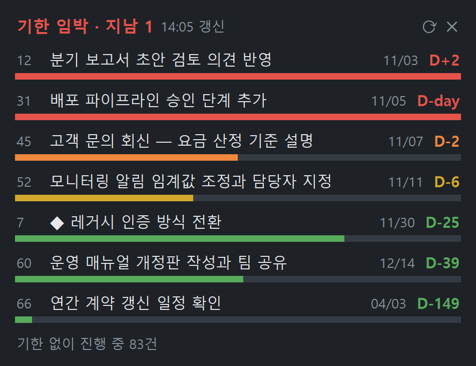

# Jira Schedule Widget

내 Jira 이슈 중 **기한이 가까운 것**을 Windows 바탕화면에 포스트잇처럼 늘 띄워 두는 작은 위젯입니다.
Jira를 열지 않아도 무엇이 급한지 한눈에 보입니다.



- 내 담당이고 아직 완료되지 않은 이슈 중 기한이 있는 것을 **기한 순으로 7건** 보여 줍니다
- 막대는 **생성일부터 기한까지 시간이 얼마나 흘렀는지**를 나타냅니다.
  색은 남은 일수로 정합니다: 기한 지남·당일 🔴, 2일 이내 🟠, 7일 이내 🟡, 그 외 🟢
- 맨 아래 줄은 **기한 없이 진행 중인 이슈 수**입니다. 기한을 안 잡아서 놓치는 일을 줄이려고 넣었습니다
- 10분마다 새로 불러오고, 항목을 클릭하면 브라우저에서 그 이슈가 열립니다

## 요구 사항

- Windows 10 / 11
- [python.org](https://www.python.org/downloads/windows/) 또는 Python Install Manager로 설치한 **Python 3.10 이상**
  (tkinter 포함. Microsoft Store 판은 시험하지 않았습니다)
- Jira Cloud 계정과 [API 토큰](https://id.atlassian.com/manage-profile/security/api-tokens)

외부 패키지는 쓰지 않습니다. 표준 라이브러리만 사용합니다.

## 설치

```powershell
git clone https://github.com/ldy9037/Jira-schedule-widget.git
cd Jira-schedule-widget
python jira_widget.pyw --install
```

설치하면 다음이 일어납니다.

1. `%LOCALAPPDATA%\JiraWidget\`로 위젯을 **복사**합니다
2. **시작프로그램**과 **바탕화면**에 `Jira 기한 위젯` 바로가기를 만듭니다. 로그인할 때마다 자동으로 뜹니다
3. 위젯을 바로 실행합니다

처음 실행하면 로그인 창이 뜹니다.

| 칸 | 넣을 값 |
|---|---|
| Jira 사이트 주소 | `https://<회사>.atlassian.net` |
| Atlassian 이메일 | Jira 로그인 이메일 |
| API 토큰 | [id.atlassian.com](https://id.atlassian.com/manage-profile/security/api-tokens)에서 발급 |

저장하면 그 자리에서 Jira에 한 번 확인 호출을 보내고, 성공해야 저장합니다.

> 설치본은 복사본입니다. 코드를 새로 받았으면(`git pull`) `--install`을 다시 실행해야 반영됩니다.

설치 없이 한 번만 띄워 보려면 `pythonw jira_widget.pyw`를 실행하세요. 화면만 미리 보려면 `python jira_widget.pyw --demo`를 실행하면 가짜 데이터로 뜹니다.

## 사용법

| 동작 | 방법 |
|---|---|
| 이동 | 맨 위 제목 줄을 끈다 |
| 폭 조절 | 창의 **왼쪽·오른쪽 가장자리**를 끈다 (커서가 ↔ 로 바뀝니다) |
| 이슈 열기 | 항목 클릭 |
| 바로 새로고침 | 오른쪽 위 ⟳ |
| 메뉴 | 아무 곳이나 **우클릭** — 새로고침 / 항상 위 / Jira에서 전체 보기 / 로그인 정보 다시 입력 / 설정 파일 열기 / 종료 |

위치와 폭은 기억해 두었다가 다음에 그대로 엽니다. 이미 떠 있는 상태에서 다시 실행해도 두 개가 뜨지 않습니다.

## 설정

`%APPDATA%\JiraWidget\config.json` (우클릭 › 설정 파일 열기). 고친 뒤 위젯을 다시 켜면 반영됩니다.

| 키 | 기본값 | 설명 |
|---|---|---|
| `site` | (첫 실행 때 입력) | Jira 사이트 주소. `https://`만 받습니다 |
| `jql` | `assignee = currentUser() AND statusCategory != Done AND duedate is not EMPTY ORDER BY duedate ASC, created ASC` | 목록에 띄울 이슈 |
| `jql_no_due` | `assignee = currentUser() AND statusCategory = "In Progress" AND duedate is EMPTY` | 맨 아래 "기한 없이 진행 중 N건"을 세는 조건 |
| `max_items` | `7` | 표시할 건수 |
| `refresh_min` | `10` | 새로고침 주기(분) |
| `topmost` | `true` | 항상 다른 창 위에 표시 |
| `alpha` | `0.94` | 불투명도 (0~1) |
| `width` | `340` | 창 폭. 가장자리를 끌면 바뀝니다 |

예를 들어 특정 프로젝트만 보고 싶다면 `jql` 앞에 `project = ABC AND `를 붙이면 됩니다.

## 제거

```powershell
python jira_widget.pyw --uninstall
```

바로가기, 설치본, 설정 파일, 저장된 토큰을 모두 지웁니다. 실행 중인 위젯은 먼저 우클릭 › 종료로 꺼 주세요.

## 보안

이 위젯은 API 토큰을 다루므로 아래처럼 만들었습니다.

- **토큰은 Windows 자격 증명 관리자에만 저장합니다** (`JiraWidget:atlassian`, 일반 자격 증명).
  설정 파일이나 로그에는 남기지 않습니다. 저장된 항목은 `cmdkey /list:JiraWidget*`로 확인하고,
  `cmdkey /delete:JiraWidget:atlassian`으로 지울 수 있습니다
- **`https://` 주소에만 연결합니다.** 토큰을 Basic 인증 헤더로 보내기 때문에 `http://` 주소는 거부합니다
- **리다이렉트를 따라가지 않습니다.** 파이썬 `urllib`은 리다이렉트할 때 `Authorization` 헤더를 다른 호스트로도
  그대로 넘깁니다. 토큰이 엉뚱한 곳으로 새지 않도록 리다이렉트 응답은 오류로 처리합니다
- 접속하는 곳은 설정한 Jira 사이트 하나뿐입니다. 사용하는 API는 `GET /rest/api/3/search/jql`,
  `POST /rest/api/3/search/approximate-count`, `GET /rest/api/3/myself`(로그인 확인)이고 **모두 읽기**입니다.
  위젯은 Jira에 아무것도 쓰지 않습니다
- 토큰 권한은 그 계정의 권한과 같습니다. 필요하면 만료일을 짧게 잡아 발급하세요.
  만료되면 위젯에 "인증 실패"가 뜨고, 우클릭 › 로그인 정보 다시 입력으로 새 토큰을 넣으면 됩니다

## 문제 해결

| 증상 | 확인할 것 |
|---|---|
| `인증 실패` | 토큰이 만료됐거나 이메일이 틀렸습니다. 우클릭 › 로그인 정보 다시 입력 |
| `연결 실패` | 네트워크·프록시. 사내망에서 `*.atlassian.net`이 막혀 있지 않은지 |
| `Jira 주소가 다른 곳으로 넘어감` | 사이트 주소가 옛 주소이거나 오타입니다. 브라우저 주소창의 `https://….atlassian.net`을 그대로 넣으세요 |
| 위젯이 안 보인다 | 화면 밖으로 나갔을 수 있습니다. `config.json`에서 `x`, `y`를 `null`로 바꾸고 다시 켜세요 |
| 글자가 흐리다 | 화면 배율을 바꾼 뒤라면 위젯을 다시 켜세요 |

## 라이선스

[MIT](LICENSE)
